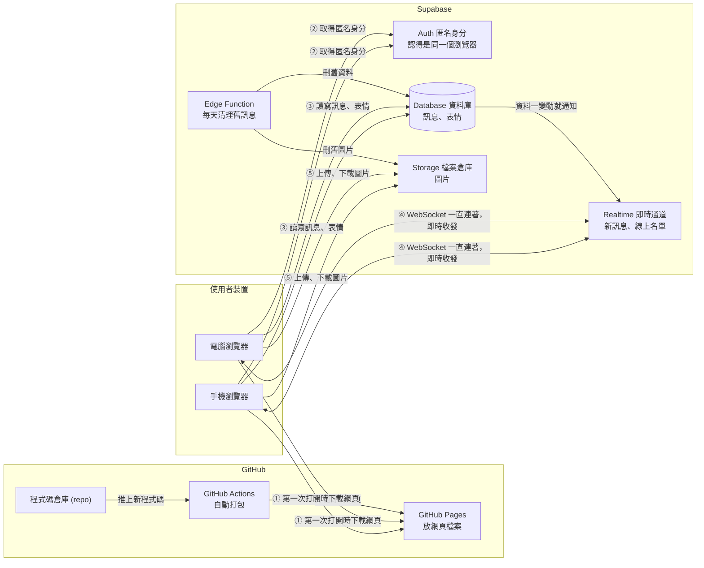
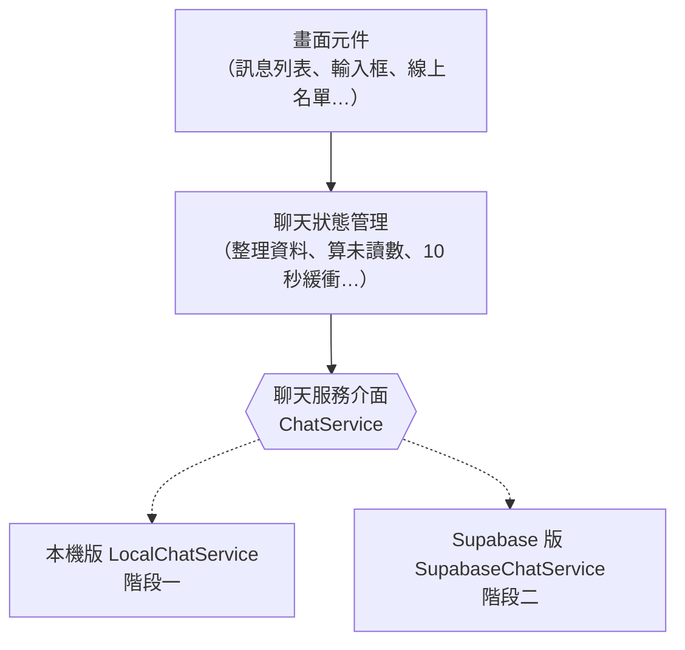
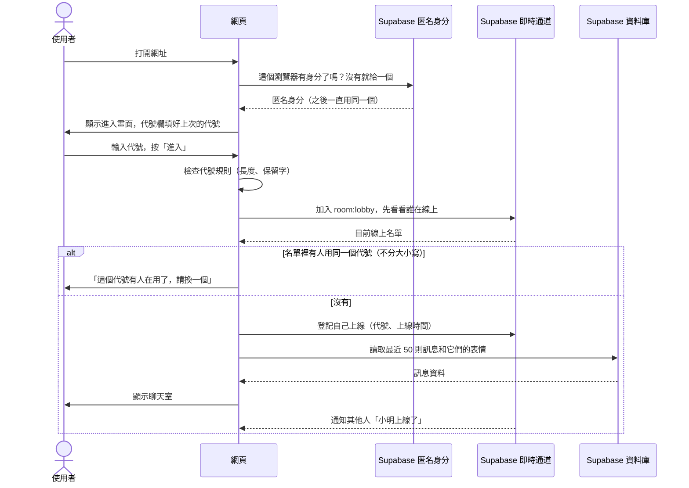
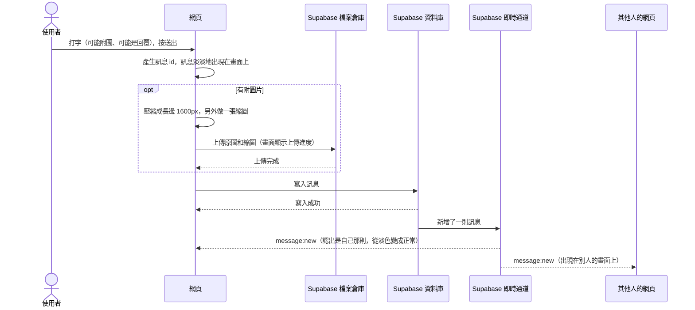
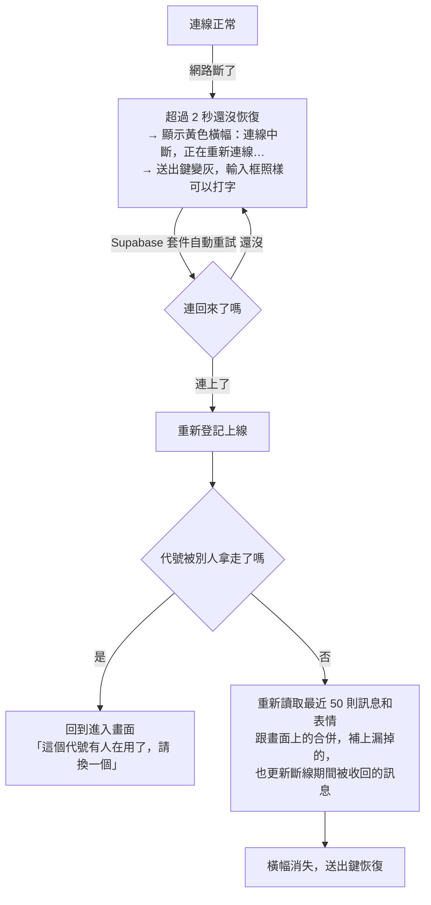

# 匿名聊天室 架構文件

> 本文件根據 `docs/requirements.md` 和需求訪談的結果撰寫，寫作日期是 2026 年 10 月。
> 讀者是不寫程式的專案負責人，所以專有名詞第一次出現時，會用一句話解釋。

---

## 1. 專案說明與目標

### 這是什麼
一個**不用註冊、不用登入**的網頁聊天室。拿到網址的人，用電腦或手機打開，輸入一個代號就能進去。所有人都在同一個聊天室裡，可以傳文字、圖片、回覆別人、按表情，也看得到誰在線上、誰進來了、誰離開了。

### 目標
1. **打開就能聊**：除了輸入代號，沒有其他步驟。
2. **即時**：別人送出的訊息、按的表情、進出聊天室，都在一兩秒內出現在自己的畫面上。
3. **手機和電腦都好用**：版面會配合螢幕寬度調整。
4. **不花錢**：網頁放在 GitHub Pages（免費），即時傳訊和資料存在 Supabase 的免費方案。
5. **分兩階段做**：先把畫面做完整、放上網看得到，最後再接上 Supabase，而且接上時不用重寫畫面。

### 功能總表（訪談確認的結果）

| 類別 | 內容 |
|---|---|
| 進入 | 代號 1～12 個字，頭尾空白自動去掉；線上不能有人同名，大小寫算同一個（Tom = tom）；「系統」、「管理員」、「admin」不能用；下次打開時代號欄預先填好上次的代號 |
| 歷史 | 一進來看到最近 50 則訊息，不能再往上載入更舊的 |
| 文字 | 最多 500 字；網址自動變成可以點的連結；空白訊息不能送 |
| 圖片 | 一則訊息最多一張圖，可以附文字；用 📎 選圖，電腦版也可以貼上或拖曳；支援 jpg、png、gif、webp；長邊自動壓到 1600px（GIF 不壓縮，上限 3MB）；聊天室裡顯示縮圖，點了全螢幕放大 |
| 訊息外觀 | 自己的訊息靠右、別人的靠左；每則顯示時:分，跨日時插入日期分隔線；同一個人 1 分鐘內連續送的訊息，只有第一則顯示代號 |
| 收回 | 送出後 2 分鐘內可以收回自己的訊息，所有人看到「〇〇 收回了一則訊息」 |
| 回覆 | 可以引用一則訊息來回覆，點引用區會捲到原訊息 |
| 表情 | 固定 6 個：👍 ❤️ 😂 😮 😢 🙏；同一則訊息可以按好幾種，再按一次就取消 |
| 線上 | 電腦版右邊一欄列出線上名單；手機版頂端顯示人數，點了展開 |
| 進出提示 | 夾在訊息之間的灰字，不存進歷史；斷線後 10 秒內回來不顯示 |
| 通知 | 往上捲時出現「↓ N 則新訊息」；網頁不在前面時分頁標題顯示未讀數；沒有聲音、沒有系統通知 |
| 連線 | 斷線時顯示黃色橫幅，連回來後自動補上漏掉的訊息；送失敗可以重試或刪除 |
| 外觀 | 繁體中文；深色模式跟著系統設定 |

---

## 2. 整體架構圖

> **mermaid**：一種用文字畫圖的格式，GitHub 會自動把它顯示成圖。



**怎麼看這張圖：**
- **GitHub Pages** 只負責「把網頁送到使用者的瀏覽器」。網頁下載完之後，聊天的事情都不經過 GitHub。
- **瀏覽器**下載網頁後，直接連到 **Supabase**：訊息存在資料庫，圖片存在 Storage，「有新訊息」「誰上線了」透過 Realtime 即時推送。
- **WebSocket**：瀏覽器和伺服器之間一條一直開著的連線，伺服器有新東西可以馬上推過來，不用瀏覽器一直問「有沒有新訊息」。
- 我們**沒有自己的伺服器**。所有「後端」工作都交給 Supabase，所以不用管理主機，也不用錢。

---

## 3. 技術選擇

### 3.1 前端

> **前端**：在使用者瀏覽器裡跑的程式，也就是使用者看到、點到的畫面。

| 項目 | 選了什麼 | 為什麼 |
|---|---|---|
| 程式語言 | **TypeScript** | TypeScript 是「加上型別檢查的 JavaScript」，JavaScript 則是瀏覽器唯一看得懂的程式語言。型別檢查會在程式執行前就抓出「欄位名稱打錯」「少傳一個值」這類錯誤。這個專案前後端交換的資料格式很多（訊息、表情、線上名單），型別檢查能確保兩階段的資料格式一致。 |
| 畫面框架 | **React** | 框架是一套寫畫面的現成規則和工具。React 是目前最多人用的框架，教學、範例和 AI 工具的支援都最多，以後找人或找 AI 幫忙都比較容易。`/frontend-design` 產出 React 元件的效果也很好。 |
| 打包工具 | **Vite** | 打包工具把我們寫的許多檔案整理、壓縮成瀏覽器能直接讀的少數幾個檔案。Vite 設定很少、速度快，打包出來就是一般的靜態檔案，正好可以放上 GitHub Pages。 |
| 狀態管理 | **React 內建功能**（useReducer + Context） | 「狀態」是畫面目前的資料，例如有哪些訊息、誰在線上。這個專案只有一個聊天室，規模不大，不需要額外的套件。 |
| 樣式 | 由 `/design` 和 `/frontend-design` 決定 | 本文件不規定顏色和樣式。 |
| 測試 | **Vitest**（小功能測試）＋ **Playwright**（模擬真人操作瀏覽器） | Vitest 測「代號規則」「網址變連結」這類小邏輯；Playwright 自動開兩個分頁互傳訊息，確認整個流程能用。 |

**沒選的方案：**
- **Next.js**：功能很多，但它最大的好處要搭配伺服器才用得到。GitHub Pages 只能放靜態檔案，用了反而綁手綁腳。
- **不用框架、直接寫 HTML**：一開始比較簡單，但這個聊天室的畫面狀態很多（送出中、失敗、收回、回覆、表情、斷線…），沒有框架很快就會亂掉。

### 3.2 Supabase

> **Supabase**：一個雲端服務，一次提供資料庫、登入、檔案儲存、即時推送等後端功能，有免費方案。

| 用到的功能 | 用來做什麼 | 為什麼 |
|---|---|---|
| **Anonymous Sign-Ins（匿名登入）** | 瀏覽器第一次打開網頁時，在背景自動拿到一個匿名身分（一串隨機 ID），使用者完全不會看到任何登入畫面 | 「只能收回自己的訊息」「自己的訊息靠右」都要先認得「這則是誰送的」。匿名身分存在瀏覽器裡，重新整理後還是同一個人，正好符合「同一個瀏覽器才能收回」。伺服器端也能用這個身分檢查權限，別人沒辦法假冒。 |
| **Database（資料庫，PostgreSQL）** | 存訊息和表情回應 | 新進來的人要看到最近 50 則訊息，訊息就必須存在某個地方。PostgreSQL 是一套成熟、免費的資料庫軟體，Supabase 用的就是它。 |
| **Row Level Security（RLS，資料列權限規則）** | 在資料庫裡規定「誰可以讀、寫、改哪一筆資料」 | 網頁的程式碼任何人都看得到，所以安全不能靠前端。RLS 是資料庫自己把關的規則，例如「只能用自己的身分送訊息」，就算有人繞過網頁直接呼叫資料庫也擋得住。 |
| **Realtime：Postgres Changes** | 資料庫裡一新增訊息、收回訊息或加減表情，就推送給所有線上的人 | 訊息本來就要寫進資料庫，讓資料庫在寫入時順便通知大家，就不會出現「畫面上有、資料庫沒有」的不一致。 |
| **Realtime：Presence（在線狀態）** | 線上名單、進出提示、檢查代號有沒有人在用 | Presence 專門用來追蹤「現在誰連著」。斷線或關掉網頁時，Supabase 會自動通知其他人，不用我們自己寫。 |
| **Storage（檔案倉庫）** | 存圖片和縮圖 | 圖片太大，不適合放進資料庫。Storage 提供網址讓瀏覽器直接下載，也可以設定檔案大小和格式的上限。 |
| **Edge Functions ＋ Cron（排程）** | 每天自動清掉 7 天前的舊訊息和它們的圖片（最近 50 則一定保留） | Edge Function 是放在 Supabase 上、需要時才執行的一小段程式；Cron 是「每天幾點自動做某件事」的排程。畫面上只會顯示最近 50 則訊息，舊的留著只會吃掉免費額度。 |

**沒選的方案：**
- **Realtime Broadcast（廣播）傳訊息**：廣播比較快，但訊息不會被存起來，還要另外處理「存進資料庫」和「推送」兩件事不同步的問題。這個聊天室的規模用 Postgres Changes 就夠了。

---

## 4. 兩個階段

### 4.1 核心設計：「聊天服務」這個轉接頭

兩個階段之間不用重寫的關鍵是：**畫面不直接跟 Supabase 講話，而是透過一個「聊天服務」轉接頭。**

> **介面（interface）**：一份「這個東西必須提供哪些功能」的約定。只要遵守同一份約定，背後怎麼做都可以換。



- **畫面元件**只負責顯示和接收點擊，完全不知道訊息是從哪裡來的。
- **聊天狀態管理**負責所有「使用者看得到的規則」，例如 1 分鐘內合併代號、10 秒內回來不顯示進出提示、未讀數、送出中和失敗的狀態。這些規則兩個階段都一樣，只寫一次。
- **聊天服務介面**規定「進入、離開、送訊息、收回、按表情、收到新訊息…」這些動作和事件的格式（詳見第 5 節）。
- 階段一用**本機版**，階段二換成 **Supabase 版**。程式啟動時看有沒有設定 Supabase 的網址：有就用 Supabase 版，沒有就用本機版。**畫面元件和狀態管理一行都不用改。**

### 4.2 階段一：還沒接 Supabase

**目標：除了「不同裝置之間真的互傳」，所有畫面和互動都做完、可以操作，而且放上 GitHub Pages 看得到。**

本機版聊天服務用瀏覽器內建的功能模擬一個聊天室：

| 要模擬的事 | 怎麼模擬 |
|---|---|
| 多人聊天 | 用 **BroadcastChannel**（瀏覽器內建，讓同一台電腦、同一個瀏覽器的不同分頁互相傳話）。開兩個分頁、取兩個代號，就能互傳訊息、按表情、收回、看到彼此上線。 |
| 歷史訊息 | 訊息存在 **IndexedDB**（瀏覽器內建的小型資料庫，關掉網頁也不會消失），重新整理後還看得到最近 50 則。 |
| 一個人測試 | 網址加上 `?demo=1`，會出現 2 個模擬使用者（例如「小貓」和「阿土」），他們會偶爾進出、說話、按表情，用來檢查進出提示和別人的訊息長什麼樣子。 |
| 斷線、失敗 | 網址加上 `?debug=1`，畫面角落出現測試面板，可以按「模擬斷線」「讓下一則訊息送失敗」「讓上傳變慢」，用來檢查黃色橫幅、⚠ 傳送失敗、上傳進度這些狀態。 |
| 匿名身分 | 第一次打開時產生一個隨機 ID 存在瀏覽器裡，作用跟階段二的匿名身分一樣。 |

**階段一做到的程度：**
- 第 7 節的所有畫面和行為都已完成。
- 代號規則、代號重複檢查（在同一個瀏覽器的分頁之間檢查）、2 分鐘收回、回覆、表情、圖片壓縮和縮圖、深色模式、手機版面，全部能操作。
- 畫面頂端有一條小提示：「展示模式：訊息只存在這台裝置的瀏覽器裡」，避免有人以為已經可以跟別人聊天。

**怎麼在 GitHub Pages 上看效果：** 照第 12 節設定好自動部署後，每次把程式推上 GitHub，幾分鐘後網址就會更新。打開 `https://zl900525.github.io/class1/`（假設 repo 名稱是 `class1`），加上 `?demo=1` 就能看到有「別人」在聊天的樣子。

### 4.3 階段二：接上 Supabase

**會改變的：**
1. 在 Supabase 建立專案，執行資料表和權限規則的設定（放在 `supabase/migrations/`）。
2. 新增 `SupabaseChatService`，照著同一份聊天服務介面寫。
3. 把 Supabase 網址和公開金鑰設定到 GitHub（見第 8 節），重新部署。程式看到有設定，就自動改用 Supabase 版。
4. 頂端的「展示模式」提示自動消失。
5. 設定每天清理舊訊息的排程。

**不會改變的：**
- 所有畫面元件、聊天狀態管理、代號規則、圖片壓縮、網址變連結，都不用動。
- 本機版保留下來，以後改畫面時，不用連網路、也不會弄髒正式的聊天室資料，就能測試。

**階段二才有、階段一模擬不了的：**
- 不同裝置之間真的互傳。
- 代號重複檢查跨裝置生效。
- 伺服器端把關（RLS、檔案大小上限、2 分鐘收回的時間檢查）。

---

## 5. 通訊約定

### 5.1 資料格式

> **UUID**：一串隨機產生、幾乎不可能重複的 ID，例如 `3f1c9a2e-7b4d-4e8a-9c21-5d0e6f7a8b90`。

**訊息（Message）**
```json
{
  "id": "3f1c9a2e-7b4d-4e8a-9c21-5d0e6f7a8b90",
  "senderId": "a7e0…（送出者的匿名身分）",
  "nickname": "小明",
  "text": "大家看這個 https://example.com",
  "image": {
    "url": "https://…/chat-images/a7e0…/3f1c….jpg",
    "thumbUrl": "https://…/chat-images/a7e0…/3f1c…_thumb.jpg",
    "width": 1600,
    "height": 1200
  },
  "replyTo": "（被回覆訊息的 id，沒有就是 null）",
  "createdAt": "2026-10-13T06:32:10.123Z",
  "recalledAt": null
}
```

| 欄位 | 說明 |
|---|---|
| `id` | 由送出的瀏覽器先產生。這樣訊息還沒送到伺服器前就能顯示在畫面上；伺服器推送回來時，也認得出是同一則，不會出現兩次。 |
| `senderId` | 判斷「是不是我送的」（靠右顯示、能不能收回）。 |
| `nickname` | 送出當下的代號。之後這個人換了代號，舊訊息也不會跟著變。 |
| `text` | 0～500 字。有圖片時可以是空的。 |
| `image` | 沒有圖片就是 `null`。`width`、`height` 讓畫面在圖片下載完之前先留好位置，訊息列表才不會跳動。 |
| `replyTo` | 回覆的對象。畫面會用這個 id 找到原訊息，顯示引用區。 |
| `createdAt` | **以伺服器的時間為準**，避免有人把自己電腦的時間調錯。 |
| `recalledAt` | 收回的時間。不是 `null` 就代表已收回，這時 `text` 和 `image` 都會被清空。 |

**表情回應（Reaction）**
```json
{ "messageId": "3f1c…", "userId": "b81d…", "nickname": "小華", "emoji": "👍" }
```
- `emoji` 只能是 👍 ❤️ 😂 😮 😢 🙏 其中一個。
- 同一人、同一則訊息、同一個表情，最多一筆（再按一次就是刪掉這筆）。

**線上的人（PresenceUser）**
```json
{ "userId": "a7e0…", "tabId": "（每個分頁各自的隨機 id）", "nickname": "小明", "onlineAt": "2026-10-13T06:30:00.000Z" }
```
- 同一個瀏覽器開好幾個分頁、用同一個代號，算同一個人，名單上只出現一次。
- `onlineAt` 用來決定「兩個人同時搶同一個代號」時誰先到（見 6.1）。

**連線狀態（ConnectionStatus）**：`connecting`（連線中）、`online`（正常）、`reconnecting`（斷線、重連中）。

### 5.2 聊天服務介面：畫面可以叫它做的事

| 動作名稱 | 做什麼 | 結果 |
|---|---|---|
| `join(nickname)` | 用這個代號進入聊天室 | 成功；或失敗，並附上原因：`nickname_taken`（有人在用）、`invalid`（不符合規則）、`network`（連不上） |
| `leave()` | 離開聊天室 | — |
| `loadRecent()` | 取得最近 50 則訊息和它們的表情 | 訊息列表 |
| `fetchMessages(ids)` | 取得被回覆、但不在這 50 則裡的原訊息 | 訊息列表（找不到的就不回傳） |
| `sendMessage({ id, nickname, text, image, replyTo })` | 送出訊息；`image` 是已經壓縮好的圖片（壓縮在狀態管理裡做，兩個階段共用），上傳過程中會回報進度（0～100%） | 成功；或失敗（畫面顯示 ⚠，重試時用同一個 `id` 再送一次） |
| `recall(messageId)` | 收回自己的訊息 | 成功；或失敗，並附上原因：`too_late`（超過 2 分鐘）、`not_owner`（不是自己的） |
| `toggleReaction(messageId, emoji, nickname)` | 按表情，或取消已經按過的表情 | 成功或失敗 |

### 5.3 聊天服務介面：會通知畫面的事件

| 事件名稱 | 什麼時候發生 | 附帶資料 |
|---|---|---|
| `message:new` | 有新訊息（包含自己送出的訊息「確認送達」） | Message |
| `message:recalled` | 有訊息被收回 | `{ messageId }` |
| `reaction:added` | 有人按了表情 | Reaction |
| `reaction:removed` | 有人取消了表情 | Reaction |
| `presence:sync` | 線上名單更新（剛進入時拿到完整名單，之後有變動也會再發） | PresenceUser 列表 |
| `presence:join` | 有人上線 | PresenceUser |
| `presence:leave` | 有人斷線或離開 | PresenceUser |
| `connection:status` | 連線狀態改變 | ConnectionStatus |
| `session:kicked` | 自己被擠下線（代號跟先到的人重複了，見 6.1） | `{ reason: "nickname_taken" }` |

> 注意：`presence:join` 和 `presence:leave` 是「原始事件」。要不要在畫面上顯示「〇〇 進入／離開了聊天室」，由聊天狀態管理套用 10 秒緩衝規則後再決定（見 6.3）。

### 5.4 階段二在 Supabase 上的對應

| 介面上的東西 | Supabase 上的實際做法 |
|---|---|
| 聊天室頻道 | Realtime 頻道，名稱是 `room:lobby` |
| `presence:*` | 這個頻道的 Presence 功能，每個分頁登記自己的 PresenceUser |
| `message:new` | 訂閱 `messages` 資料表的「新增」通知 |
| `message:recalled` | 訂閱 `messages` 資料表的「修改」通知（`recalledAt` 從空的變成有值） |
| `reaction:added` / `reaction:removed` | 訂閱 `reactions` 資料表的「新增」「刪除」通知 |
| `recall()` | 呼叫資料庫裡的函式 `recall_message`，它會檢查「是不是本人」和「有沒有超過 2 分鐘」，然後清空內容、刪掉這則訊息的表情 |
| 圖片 | 存在 Storage 的 `chat-images` 倉庫，路徑是 `匿名身分/訊息id.jpg`，縮圖是 `…_thumb.jpg` |

**資料表：**

`messages`（訊息）

| 欄位 | 規則（由資料庫強制檢查） |
|---|---|
| id | UUID，不能重複 |
| sender_id | 必須等於送出者自己的匿名身分 |
| nickname | 1～12 字，不能是保留字 |
| text | 最多 500 字 |
| image_path、thumb_path、image_width、image_height | 可以是空的 |
| reply_to | 指向另一則訊息；原訊息被刪掉時自動變成空的 |
| created_at | 一律由伺服器填入目前時間，前端送來的值不採用 |
| recalled_at | 只能透過 `recall_message` 函式修改 |
| （整體規則） | 沒收回的訊息，文字和圖片至少要有一個 |

`reactions`（表情回應）

| 欄位 | 規則 |
|---|---|
| message_id | 指向訊息；訊息被刪掉時，表情一起刪掉 |
| user_id | 必須等於自己的匿名身分 |
| nickname | 按的時候的代號 |
| emoji | 只能是那 6 個 |
| （整體規則） | 「訊息＋人＋表情」不能重複；只能刪自己按的 |

---

## 6. 資料流

以下以階段二為準。階段一的流程完全一樣，只是「Supabase」換成「同一個瀏覽器的其他分頁」。

### 6.1 進入聊天室



**補充說明：**
- **代號存在瀏覽器裡**：進入成功後，代號會存進瀏覽器的 localStorage（瀏覽器內建的小儲存空間，關掉網頁也還在），下次打開時預先填好。
- **兩個人同時搶同一個代號**：兩人幾乎同時按下「進入」時，可能都通過檢查。進入後，每個人的網頁會持續比對線上名單，如果發現有人跟自己同名、而且比自己早上線（`onlineAt` 比較早；一樣早就比 `userId`），晚到的那個人會被送回進入畫面，看到「這個代號有人在用了，請換一個」。
- **代號比對方式**：比對前，先把全形英數字轉成半形、拿掉看不見的字元，再忽略大小寫。這樣「Ｔｏｍ」「Tom」「tom」會被當成同一個代號。

### 6.2 送出訊息



**失敗時：**
- 上傳圖片或寫入訊息失敗，那則訊息就標示「⚠ 傳送失敗」，旁邊有「重試」和「刪除」。
- 「重試」會用**同一個訊息 id** 重新送一次。如果其實上次已經寫進去了，資料庫會發現 id 重複而直接略過，不會變成兩則。
- 「刪除」只是從自己的畫面拿掉，因為這則訊息根本沒有送出去。

**收回：** 使用者按「收回」→ 網頁呼叫 `recall_message` → 資料庫確認是本人、而且在 2 分鐘內 → 清空文字和圖片欄位、刪掉這則訊息的表情 → 網頁刪掉 Storage 裡的圖片檔 → 所有人收到 `message:recalled`，那則訊息變成「〇〇 收回了一則訊息」。超過時間的話，畫面顯示「已超過可收回的時間」。

**表情：** 按下表情時，畫面先立刻更新，同時寫入資料庫；失敗的話就把畫面改回去，並短暫顯示「操作失敗」。

### 6.3 離開

| 怎麼離開 | 發生什麼事 |
|---|---|
| 按「離開」按鈕 | 網頁取消上線登記、斷開頻道，回到進入畫面 |
| 關掉分頁或瀏覽器 | 連線中斷，Supabase 幾秒內發現並通知其他人 |
| 手機切到別的 app 太久 | 手機系統可能暫停網頁的連線，效果跟關掉一樣；切回來時會自動重連（見 6.4） |

**其他人那邊的「10 秒緩衝」：**
1. 收到 `presence:leave`（小明不見了）→ 先不顯示，開始倒數 10 秒，線上名單也先保留小明。
2. 10 秒內又收到小明的 `presence:join` → 取消倒數，什麼提示都不顯示（例如他只是重新整理）。
3. 10 秒到了小明都沒回來 → 名單拿掉小明，訊息之間出現「小明 離開了聊天室」。
4. 新上線的人如果不在倒數名單裡 → 馬上顯示「〇〇 進入了聊天室」。
5. 自己剛進入時拿到的完整名單，不會讓每個人都跳一次「進入了聊天室」。

### 6.4 斷線與重連



- 斷線時正在送出的訊息會變成「⚠ 傳送失敗」，連回來後**不會自動重送**，由使用者決定要不要重試，避免同一句話突然冒出來。
- 只斷線 10 秒內的話，其他人不會看到這個人離開又進來（見 6.3）。
- 2 秒的門檻是為了不讓網路短暫閃一下就跳出橫幅。

---

## 7. 畫面清單

> 本節只規定「有什麼」和「做什麼」，顏色、字型、間距等等由 `/design` 決定。

### 7.1 進入畫面

| 元素 | 行為 |
|---|---|
| 聊天室名稱和一句說明 | 純顯示 |
| 代號輸入框 | 預先填好上次用過的代號；打字時即時檢查規則；最多 12 個字 |
| 錯誤提示 | 顯示在輸入框下方：「請輸入代號」「代號最多 12 個字」「這個代號不能使用」「這個代號有人在用了，請換一個」「連不上伺服器，請稍後再試」 |
| 「進入」按鈕 | 代號不合規則時是灰的；按下後顯示「進入中…」，避免重複按；在輸入框按 Enter 也算按下 |
| 展示模式提示（只在階段一） | 「展示模式：訊息只存在這台裝置的瀏覽器裡」 |

### 7.2 聊天室主畫面

**頂端列**

| 元素 | 行為 |
|---|---|
| 聊天室名稱 | 純顯示 |
| 線上人數「👥 N」 | 手機版：點了展開或收起線上名單。電腦版：純顯示 |
| 「離開」按鈕 | 按了回到進入畫面，代號欄保留目前的代號 |
| 黃色連線橫幅 | 斷線超過 2 秒才出現，連回來就消失 |
| 展示模式提示（只在階段一） | 同 7.1 |

**線上名單**（電腦版在右邊固定一欄，手機版從頂端展開）

| 元素 | 行為 |
|---|---|
| 標題「線上 N 人」 | 跟著名單變動 |
| 代號列表 | 自己排第一個，標「（你）」；其他人依上線順序排列 |

**訊息列表**

| 元素 | 行為 |
|---|---|
| 訊息泡泡 | 自己的靠右，別人的靠左。別人的訊息上方顯示代號；同一個人 1 分鐘內連續送的訊息，只有第一則顯示代號（中間夾了進出提示或日期分隔線，就重新顯示） |
| 時間 | 每則顯示「時:分」，依使用者裝置的時區 |
| 日期分隔線 | 前後兩則訊息不同天時插入，例如「── 10 月 12 日 ──」；今天顯示「── 今天 ──」 |
| 文字內容 | 保留換行；`http://` 和 `https://` 開頭的網址變成可以點的連結，點了在新分頁開啟 |
| 圖片縮圖 | 下載完成前先用圖片的長寬比例留好位置；點了打開全螢幕檢視 |
| 引用區（回覆時才有） | 顯示原訊息的代號和前面一段文字（最多約 50 字，原訊息是圖片就顯示「[圖片]」加小縮圖）。點了捲到原訊息並閃一下；原訊息被收回時顯示「此訊息已收回」；原訊息已經被清掉時顯示「原訊息已無法顯示」，點了沒反應 |
| 表情標籤 | 泡泡下方，例如「👍 3  ❤️ 1」。自己按過的標籤會變色；點標籤等於自己也按（或取消）同一個表情；滑鼠移上去（手機長按標籤）會顯示是誰按的 |
| 送出中狀態 | 淡色顯示；有圖片的話，縮圖上顯示上傳進度 |
| 傳送失敗狀態 | 「⚠ 傳送失敗」，旁邊是「重試」和「刪除」 |
| 已收回訊息 | 原本的泡泡換成置中的灰字「〇〇 收回了一則訊息」，表情和引用區都拿掉 |
| 進出提示 | 置中灰字「〇〇 進入了聊天室」「〇〇 離開了聊天室」，不能回覆，也不能按表情 |
| 電腦版：滑鼠移到訊息上 | 出現操作按鈕：「↩ 回覆」「☺ 表情」，自己 2 分鐘內的訊息還有「收回」 |
| 手機版：長按訊息 | 跳出選單：回覆、6 個表情、收回（只在自己 2 分鐘內的訊息出現） |
| 自動捲動 | 停在最底下時，有新訊息就自動跟著捲。往上捲超過一點距離後就不自動捲。自己送出訊息時一律捲到最底 |
| 「↓ N 則新訊息」浮動按鈕 | 往上捲的時候有新訊息才出現（只算別人的訊息）；點了捲到最底，按鈕消失 |
| 空的聊天室 | 還沒有任何訊息時，顯示「還沒有人說話，打個招呼吧」 |

**表情選擇小框**（電腦版按 ☺ 時跳出）

| 元素 | 行為 |
|---|---|
| 6 個表情 | 點一個就按下或取消，小框關閉；點小框外面或按 Esc 也會關閉 |

**輸入區**

| 元素 | 行為 |
|---|---|
| 回覆列（回覆時才有） | 在輸入框上方：「回覆 小明：今天要去哪…」，右邊的 ✕ 取消回覆。送出後自動消失 |
| 圖片預覽（選了圖片才有） | 在輸入框上方顯示小縮圖，右邊的 ✕ 取消。再選一張就取代原本那張 |
| 📎 按鈕 | 打開檔案選擇（手機上會出現相簿和相機），只能選 jpg、png、gif、webp |
| 文字輸入框 | 會隨內容長高，最多 5 行，超過就在框內捲動。電腦按 Enter 送出、Shift+Enter 換行；手機按 Enter 換行 |
| 剩餘字數 | 剩不到 50 字時才顯示，例如「剩 12 字」；超過 500 字時變成警告，送出鍵變灰 |
| 送出按鈕 | 沒有文字也沒有圖片、超過字數、或斷線時是灰的 |
| 貼上和拖曳（電腦版） | 在輸入框按 Ctrl+V 貼上圖片，或把圖片拖曳到聊天室任何地方，都會變成選圖；拖曳時畫面顯示「放開以加入圖片」 |
| 錯誤提示 | 格式不支援：「只能傳 jpg、png、gif、webp 圖片」；GIF 太大：「GIF 最大 3MB」 |

**分頁標題**

| 狀態 | 標題 |
|---|---|
| 網頁在前面 | 「匿名聊天室」 |
| 網頁不在前面、有未讀訊息 | 「(3) 匿名聊天室」，只算別人的訊息；切回來時歸零 |

### 7.3 圖片全螢幕檢視

| 元素 | 行為 |
|---|---|
| 原尺寸圖片 | 盡量放大到填滿螢幕，但不超過原尺寸，保持比例 |
| 關閉 | 點一下畫面任何地方，或按 Esc，就關閉 |
| 圖片被收回 | 如果正在看的時候圖片被收回，關閉後就打不開了，訊息已經變成「〇〇 收回了一則訊息」 |

### 7.4 測試面板（只在網址加上 `?debug=1` 時出現）

| 元素 | 行為 |
|---|---|
| 模擬斷線／恢復 | 切換連線狀態 |
| 下一則訊息送失敗 | 下一次送出必定失敗 |
| 上傳變慢 | 讓上傳進度慢慢跑，方便檢查進度顯示 |
| 目前使用：本機版／Supabase 版 | 純顯示 |

---

## 8. 金鑰

> **金鑰**：一串很長的文字，用來證明「我有權限使用這個 Supabase 專案」。有些可以公開，有些一旦外流，別人就能刪光你的資料。

### 8.1 會用到的金鑰一覽

| 名稱 | 長什麼樣子 | 怎麼產生 | 放在哪裡 | 能不能公開 |
|---|---|---|---|---|
| **Project URL**（專案網址） | `https://abcdefgh.supabase.co` | 建立 Supabase 專案時自動產生 | 本機的 `.env.local` 檔；GitHub repo 的 Variables | ✅ 可以 |
| **Publishable key**（公開金鑰；舊版介面叫 `anon` key） | `sb_publishable_…` | 自動產生，在 Supabase 後台 Project Settings → API Keys | 同上 | ✅ 可以。它本來就會出現在網頁裡，任何人打開瀏覽器的開發者工具都看得到。真正保護資料的是第 5.4 節的資料庫規則（RLS），不是這把金鑰 |
| **Secret key**（祕密金鑰；舊版介面叫 `service_role` key） | `sb_secret_…` | 自動產生，在同一個頁面 | **只存在 Supabase 裡面**。清理用的 Edge Function 會自動拿到它，我們不用複製到任何地方 | ❌ **絕對不行**。這把鑰匙可以略過所有權限規則，拿到的人能讀、改、刪全部資料。前端完全不需要它 |
| **Database password**（資料庫密碼） | 建專案時自己設定，或按「產生」 | 建立專案時 | 密碼管理器（例如瀏覽器內建的密碼管理器、1Password、Bitwarden） | ❌ 絕對不行。這個專案平常用不到，只有直接操作資料庫時才需要 |
| **排程呼叫金鑰** | 自己產生的一串隨機文字 | 在 Supabase 後台的 Vault（加密保險箱）建立 | 只存在 Supabase Vault | ❌ 不行。用來確保只有我們自己的排程能叫清理功能執行 |

**不需要手動處理的：**
- GitHub 自動部署用的權限：GitHub Actions 自己會提供，不用產生任何金鑰。
- Supabase CLI 存取權杖：這個專案的資料庫設定是複製到 Supabase 後台的 SQL Editor 執行，不需要安裝 CLI，所以用不到。

### 8.2 公開金鑰怎麼進到網頁裡

> **環境變數**：放在程式碼外面的設定值，打包時才填進去。這樣同一份程式碼可以搭配不同的設定。

1. **本機開發**：在專案資料夾建立 `.env.local` 檔，寫入 `VITE_SUPABASE_URL` 和 `VITE_SUPABASE_PUBLISHABLE_KEY` 兩行。repo 裡另外放一份 `.env.example`，只有欄位名稱、沒有真正的值，給以後的人參考。
2. **GitHub 自動部署**：到 repo 的 Settings → Secrets and variables → Actions → **Variables** 分頁，新增同樣兩個名稱。打包時會自動填進網頁。因為這兩個值本來就會公開，所以放 Variables 就好，不用放 Secrets。
3. **兩個值都沒有設定時**，程式自動使用階段一的本機版。

### 8.3 怎麼避免金鑰被 commit 到 GitHub

> **commit**：把目前的修改存成一個版本，推上 GitHub 之後所有人都看得到，**而且就算之後刪掉，歷史紀錄裡還是查得到**。

1. **`.gitignore`**（列出「這些檔案不要放進版本紀錄」的清單）裡加上 `.env`、`.env.*`，但排除 `.env.example`。這樣 `.env.local` 永遠不會被 commit。
2. **祕密金鑰和資料庫密碼本來就不會出現在專案資料夾裡**，從源頭杜絕外流。
3. 在 GitHub repo 的 Settings → Code security 開啟 **Secret scanning** 和 **Push protection**。GitHub 認得 Supabase 祕密金鑰的格式，發現的話會直接擋下推送。
4. **萬一外流了**：到 Supabase 後台把那把金鑰作廢、產生新的。光是刪掉 commit 沒有用，因為別人可能已經複製走了。

---

## 9. 安全與限制

### 9.1 別人可以送什麼奇怪的東西進來

網頁的程式碼是公開的，有心人可以**完全不透過我們的網頁**，直接拿公開金鑰呼叫 Supabase。所以每一項防護都要問兩件事：前端有沒有擋（給一般使用者好的體驗），伺服器有沒有擋（真正的防線）。

| 可能的攻擊或怪東西 | 前端怎麼處理 | 伺服器怎麼擋 |
|---|---|---|
| 超長文字、空白訊息 | 輸入時就限制，送出鍵變灰 | 資料庫規則：500 字上限；沒收回的訊息，文字和圖片至少要有一個 |
| 在訊息裡放網頁程式碼，想讓別人的瀏覽器執行（這叫 **XSS 攻擊**） | 所有文字一律「當成文字」顯示，不當成網頁程式碼。React 預設就會這樣處理，而且我們**不使用**「直接插入 HTML」的功能 | — |
| 偽裝的連結，例如 `javascript:` 開頭、點了會執行程式的連結 | 只有 `http://`、`https://` 開頭的網址會變成連結。連結一律在新分頁開啟，而且切斷新分頁對原網頁的存取 | — |
| 冒充別人的身分送訊息、收回別人的訊息、取消別人的表情 | 介面上不提供這些按鈕 | 資料庫規則：寫入的身分一定要是自己；收回函式會檢查是不是本人、有沒有超過 2 分鐘 |
| 偽造送出時間 | — | 時間一律由伺服器填 |
| 奇怪的表情、同一個表情重複按 | 只提供 6 個表情 | 資料庫規則：只接受這 6 個，而且不能重複 |
| 冒用保留代號「系統」、「管理員」、「admin」 | 進入時擋下 | 資料庫規則：訊息的代號不能是保留字 |
| 用全形字母或看不見的字元，做出看起來一樣的代號 | 比對前先統一格式（見 6.1） | 資料庫規則：代號會先去掉看不見的字元再檢查長度 |
| 上傳超大檔案、假裝是圖片的其他檔案、含有程式碼的 SVG 圖檔 | 只接受 jpg、png、gif、webp；非 GIF 一律重新壓縮，產生全新的圖檔 | Storage 設定：單檔最大 5MB，只允許這 4 種圖片格式；只能上傳到「自己身分」的資料夾 |
| 照片裡藏著拍照地點（EXIF：照片裡附帶的拍攝資訊，可能包含 GPS 位置） | 重新壓縮時會拿掉這些資訊，保護使用者隱私（GIF 本來就沒有這類資訊） | — |
| 洗版（短時間大量送訊息） | 這一版**不擋**（訪談決定，見第 10 節） | 這一版不擋；Supabase 本身有基本的流量限制 |
| 繞過網頁、直接搶別人正在用的代號 | 網頁會檢查 | **擋不住**。線上名單是每個人自己回報的，有心人可以偽造。這是「不用登入」本來就有的限制，一般使用者不會遇到 |

### 9.2 免費方案的上限

> 以下數字是 2026 年 10 月寫作時的資料，各家方案可能調整，正式上線前請到 [supabase.com/pricing](https://supabase.com/pricing) 和 GitHub 官方文件再確認一次。

**Supabase 免費方案**

| 項目 | 上限（大約） | 對這個專案的影響 |
|---|---|---|
| 同時連線數 | 200 個 | **最可能先碰到的上限**：同時最多大約 200 個分頁在線上。超過時新的人會連不上 |
| 即時訊息量 | 每月 200 萬則 | 每一則聊天訊息會推送給每個在線的人，所以 20 人在線時，1 則訊息算 20 則。一般使用很難用完 |
| 資料庫容量 | 500MB | 每天清理舊訊息，幾乎不可能用完 |
| 檔案容量 | 1GB | 每張圖約 200～400KB（原圖＋縮圖），加上每天清理，不太會用完 |
| 流量（下載量） | 每月 5GB | **圖片是主要消耗**。所以聊天室裡一律先載入縮圖，點開才下載原圖 |
| 每月活躍使用者 | 5 萬 | 每個匿名身分算一個，很難用完 |
| 匿名登入頻率 | 預設每個 IP 每小時 30 次 | **要注意**：整個教室共用同一個網路時，學校出口可能只有一個 IP，30 個新同學同時打開網頁就會卡住。階段二要到 Authentication → Rate Limits 把這個數字調高。已經拿過身分的瀏覽器不會再算 |
| 閒置暫停 | 連續 7 天沒有使用，專案會被自動暫停 | 暫停後網頁會連不上，要到 Supabase 後台按「恢復」。長時間沒人用之後要先檢查 |

**GitHub Pages**

| 項目 | 上限 | 影響 |
|---|---|---|
| 網站大小 | 1GB | 打包後只有幾 MB，沒有影響 |
| 每月流量 | 約 100GB（建議值） | 網頁檔案很小，而且圖片不放這裡，沒有影響 |
| repo 必須公開 | 免費帳號要用 Pages，repo 必須是公開的 | 程式碼會公開，所以第 8 節的金鑰規則更加重要 |

---

## 10. 這一版刻意不做的事

| 不做的事 | 為什麼 |
|---|---|
| 註冊、登入 | 需求明定：打開就能聊 |
| 「〇〇 正在輸入…」提示 | 訪談決定不做；人一多，提示會一直閃 |
| 編輯已送出的訊息 | 已經有 2 分鐘內收回，可以收回後重送；編輯還要處理「回覆了被改過的訊息」這類複雜情況 |
| 私訊 | 需求是「所有人在同一個聊天室」；私訊需要更嚴格的身分驗證，匿名之下很難保證隱私 |
| 多個聊天室 | 同上；畫面和資料結構都會大幅變複雜 |
| 已讀標示 | 多人聊天室裡「誰讀了」意義不大，還要追蹤每個人看到哪裡，會大量消耗即時訊息額度 |
| 搜尋訊息 | 只保留最近的訊息，能搜的範圍很小 |
| 載入更舊的訊息 | 訪談決定只看最近 50 則；舊訊息每天清理，可以省下免費額度 |
| 管理者功能 | 訪談決定不做；需要另外一套「管理者身分」和管理畫面，等真的有需要再加 |
| 防洗版 | 訪談決定不做。風險：有人惡作劇時，只能等他自己停下來，或由專案負責人到 Supabase 後台手動刪資料。如果之後真的發生，最容易補上的是在資料庫加上「每個身分每 10 秒最多 5 則」的規則 |
| 提示音、系統通知 | 訪談決定不做；多人聊天室會太吵，iPhone 的網頁通知也有很多限制 |
| 「直接改名」功能 | 用「離開再進來」代替，所有人都會看到進出提示，比較不會混淆 |

---

## 11. repo 的資料夾結構

```
class1/
├─ .github/
│  └─ workflows/
│     └─ deploy.yml              # 自動打包並部署到 GitHub Pages 的步驟
├─ docs/
│  ├─ requirements.md            # 需求說明
│  └─ architecture.md            # 本文件
├─ public/                       # 原封不動放上網的檔案（網頁小圖示等）
├─ src/                          # 前端程式碼
│  ├─ main.tsx                   # 程式進入點
│  ├─ App.tsx                    # 決定顯示進入畫面還是聊天室
│  ├─ screens/                   # 整個畫面
│  │  ├─ JoinScreen.tsx          #   進入畫面
│  │  └─ ChatScreen.tsx          #   聊天室主畫面
│  ├─ components/                # 畫面裡的零件
│  │  ├─ MessageList.tsx         #   訊息列表、自動捲動、新訊息按鈕
│  │  ├─ MessageBubble.tsx       #   一則訊息
│  │  ├─ SystemNotice.tsx        #   進出提示、日期分隔線、已收回
│  │  ├─ ReplyQuote.tsx          #   引用區
│  │  ├─ ReactionBar.tsx         #   表情標籤
│  │  ├─ ReactionPicker.tsx      #   表情選擇小框
│  │  ├─ MessageMenu.tsx         #   手機長按選單
│  │  ├─ Composer.tsx            #   輸入區
│  │  ├─ OnlineList.tsx          #   線上名單
│  │  ├─ ConnectionBanner.tsx    #   黃色連線橫幅
│  │  ├─ ImageViewer.tsx         #   圖片全螢幕檢視
│  │  └─ DebugPanel.tsx          #   測試面板
│  ├─ chat/                      # 聊天的核心（畫面以外的部分）
│  │  ├─ types.ts                #   第 5.1 節的資料格式
│  │  ├─ ChatService.ts          #   第 5.2、5.3 節的介面約定
│  │  ├─ createChatService.ts    #   依設定選擇本機版或 Supabase 版
│  │  ├─ local/                  #   階段一：本機版
│  │  └─ supabase/               #   階段二：Supabase 版
│  ├─ state/                     # 聊天狀態管理（10 秒緩衝、未讀數、送出中、失敗…）
│  └─ lib/                       # 小工具，每個都有對應的測試
│     ├─ nickname.ts             #   代號規則與比對
│     ├─ linkify.ts              #   網址變連結
│     ├─ imageCompress.ts        #   圖片壓縮、縮圖、拿掉拍攝資訊
│     ├─ grouping.ts             #   1 分鐘合併代號、日期分隔線
│     └─ time.ts                 #   時間顯示
├─ supabase/
│  ├─ migrations/                # 資料表、權限規則、收回函式、Storage 設定
│  │  └─ 0001_init.sql           #   照順序貼到 Supabase SQL Editor 執行
│  └─ functions/
│     └─ cleanup/                # 每天清理舊訊息和圖片的 Edge Function
├─ tests/
│  └─ e2e/                       # Playwright 自動操作瀏覽器的測試
├─ .env.example                  # 環境變數範本（沒有真正的值）
├─ .gitignore                    # 不放進版本紀錄的檔案清單（包含 .env.local）
├─ index.html
├─ package.json                  # 專案用到的套件清單和指令
├─ tsconfig.json                 # TypeScript 設定
└─ vite.config.ts                # Vite 設定（包含 GitHub Pages 的路徑）
```

**原則：** `components/` 和 `screens/` 裡的檔案**只能**透過 `state/` 拿資料，不能直接用 `chat/local` 或 `chat/supabase`。這條規則確保換階段時畫面不用改。

---

## 12. 部署到 GitHub Pages 的方式

> **GitHub Actions**：GitHub 提供的自動化服務，可以設定成「每次推上新程式碼，就自動執行某些步驟」。

### 一次性設定
1. 確認 repo 是**公開**的（免費帳號的 Pages 需要公開 repo）。
2. repo 的 Settings → Pages → Build and deployment → Source，選 **GitHub Actions**。
3. （階段二才需要）在 Settings → Secrets and variables → Actions → Variables 加入 `VITE_SUPABASE_URL` 和 `VITE_SUPABASE_PUBLISHABLE_KEY`。
4. `vite.config.ts` 裡的網站路徑要設成 `/class1/`（跟 repo 名稱一樣），因為網址是 `https://zl900525.github.io/class1/`，不是網域的根目錄。

### 每次部署（自動）
`.github/workflows/deploy.yml` 會在**每次推送到 `main` 分支**時：
1. 準備好 Node.js 24（打包需要的執行環境）。
2. 安裝套件。
3. 執行測試。**測試沒過就停止，不會部署壞掉的版本。**
4. 用 Vite 打包，把 Variables 裡的值填進去。
5. 把打包結果交給 GitHub Pages 發布。

整個過程約 1～3 分鐘，可以在 repo 的 **Actions** 分頁看進度：綠色勾勾代表成功，紅色叉叉可以點進去看哪一步出錯。

### 階段二的 Supabase 一次性設定（照順序）
1. 到 supabase.com 建立專案，地區選 **Northeast Asia (Tokyo)**，離台灣最近。資料庫密碼存進密碼管理器。
2. Authentication → Sign In / Providers，開啟 **Anonymous sign-ins**。
3. Authentication → Rate Limits，把匿名登入的上限調高（例如每小時 200 次）。
4. SQL Editor 中，依序貼上 `supabase/migrations/` 裡的檔案並執行。這會建立資料表、權限規則、收回函式、Storage 倉庫，並開啟即時推送。
5. 部署 `cleanup` Edge Function，並在 Integrations → Cron 設定每天凌晨 4 點執行一次。
6. 把 Project URL 和 Publishable key 填進 GitHub Variables（第 8.2 節），到 Actions 分頁重新執行一次部署。

---

## 13. 驗證清單

### 13.1 階段一完成的條件

**部署**
- [ ] 推上 `main` 後，Actions 自動部署成功，`https://zl900525.github.io/class1/` 打得開
- [ ] 頂端顯示「展示模式」提示
- [ ] 重新整理任何頁面都不會出現 404

**進入**
- [ ] 空白代號、只有空白、13 個字的代號，都不能進入，並顯示對應的錯誤
- [ ] 「系統」、「管理員」、「admin」、「ADMIN」都不能用
- [ ] 分頁 A 用「Tom」進入後，分頁 B 用「tom」或「Ｔｏｍ」，會顯示「這個代號有人在用了」
- [ ] 進入後重新整理，代號欄已經填好上次的代號
- [ ] 按「離開」回到進入畫面，代號還在欄位裡

**訊息**
- [ ] 分頁 A 送出的文字，分頁 B 會即時看到
- [ ] 自己的訊息靠右、別人的靠左；別人的訊息有代號
- [ ] 同一人 1 分鐘內連送 3 則，只有第一則顯示代號；隔超過 1 分鐘再送，會重新顯示
- [ ] 每則訊息有時:分；手動放入一則昨天的訊息時，會出現日期分隔線
- [ ] 輸入 501 個字時送出鍵變灰，並顯示警告
- [ ] 訊息裡的 `https://example.com` 可以點，並在新分頁開啟；`javascript:alert(1)` 不會變成連結
- [ ] 送出 `<b>粗體</b>` 時，畫面原樣顯示這段文字，不會變成粗體
- [ ] 重新整理後，看得到最近 50 則訊息（先送 60 則來測試）
- [ ] 電腦 Enter 送出、Shift+Enter 換行；手機 Enter 換行
- [ ] 輸入框長到 5 行就不再變高

**圖片**
- [ ] 📎 選圖、Ctrl+V 貼上截圖、拖曳圖片，三種方式都能附圖
- [ ] 選 PDF 或 SVG 會顯示格式錯誤
- [ ] 一張 4000×3000 的照片，送出後原圖長邊是 1600px
- [ ] 用手機拍的直式照片，方向正確，沒有被轉倒
- [ ] 超過 3MB 的 GIF 會被擋下；3MB 以內的 GIF 送出後還是會動
- [ ] 圖片下載完成前，畫面不會跳動
- [ ] 點縮圖全螢幕放大，點一下或按 Esc 關閉
- [ ] 圖片＋文字可以一起送

**收回、回覆、表情**
- [ ] 自己的訊息 2 分鐘內有「收回」，超過 2 分鐘按鈕就消失
- [ ] 收回後，兩個分頁都顯示「〇〇 收回了一則訊息」，圖片和表情也消失
- [ ] 別人的訊息沒有「收回」
- [ ] 回覆時輸入框上方出現回覆列，✕ 可以取消
- [ ] 回覆的訊息有引用區，點了捲到原訊息並閃一下
- [ ] 原訊息被收回後，引用區顯示「此訊息已收回」
- [ ] 6 個表情都能按；同一則訊息可以按多種；再按一次就取消
- [ ] 自己按過的標籤會變色；點別人按過的標籤，等於自己也按
- [ ] 滑鼠移到標籤上（手機長按標籤），會顯示是誰按的
- [ ] 手機長按訊息會跳出選單，而且不會同時跳出系統的「複製／選取文字」選單

**線上與進出**
- [ ] 電腦版右側名單正確，自己排第一個並標「（你）」
- [ ] 手機版頂端顯示人數，點了展開名單
- [ ] 分頁 B 進入時，分頁 A 看到「〇〇 進入了聊天室」
- [ ] 分頁 B 關閉超過 10 秒，分頁 A 看到「〇〇 離開了聊天室」，名單也拿掉這個人
- [ ] 分頁 B 重新整理（10 秒內回來），分頁 A 沒有任何進出提示
- [ ] 重新整理後，歷史訊息裡沒有任何進出提示
- [ ] `?demo=1` 的模擬使用者會進出、說話、按表情

**通知與連線**（使用 `?debug=1` 測試面板）
- [ ] 往上捲時有新訊息，出現「↓ N 則新訊息」，點了捲到最底
- [ ] 停在最底下時，新訊息自動跟著捲
- [ ] 切到別的分頁時，標題顯示「(N) 匿名聊天室」，切回來歸零
- [ ] 模擬斷線超過 2 秒出現黃色橫幅，送出鍵變灰，但還能打字
- [ ] 恢復連線後橫幅消失
- [ ] 「下一則送失敗」後，訊息顯示 ⚠，按重試成功送出，而且只出現一次
- [ ] 「上傳變慢」時，縮圖上看得到進度

**外觀與相容性**
- [ ] 系統切到深色模式時，網頁自動變成深色
- [ ] 在 iPhone Safari、Android Chrome、電腦 Chrome／Edge 都能正常操作
- [ ] 手機上叫出鍵盤時，輸入框不會被鍵盤蓋住
- [ ] 所有自動測試（Vitest、Playwright）都通過

### 13.2 階段二完成的條件

**基本**
- [ ] 設定好 Variables 並重新部署後，「展示模式」提示消失，測試面板顯示「Supabase 版」
- [ ] 第 13.1 節除了「展示模式」和 `?demo=1` 以外的項目，改用**兩台不同的裝置**（例如電腦＋手機）再測一次，全部通過

**跨裝置**
- [ ] 電腦用「小明」進入後，手機用「小明」會被擋下
- [ ] 兩台裝置幾乎同時用同一個代號進入，最後只有一台留在聊天室，另一台回到進入畫面並看到提示
- [ ] 手機進電梯、或關掉 Wi-Fi 30 秒再打開：出現黃色橫幅，恢復後補上斷線期間別人送的訊息
- [ ] 手機切到別的 app 5 分鐘再切回來，會自動重連並補上訊息
- [ ] 清除瀏覽器資料後重新進入，以前的訊息變成「別人的」（靠左），而且不能收回

**伺服器把關**（請懂程式的人協助，或用 Supabase 後台的 SQL Editor 模擬）
- [ ] 直接寫入一則 501 字的訊息，被拒絕
- [ ] 用別人的身分寫入訊息，被拒絕
- [ ] 收回別人的訊息，被拒絕
- [ ] 收回自己 3 分鐘前的訊息，被拒絕，畫面顯示「已超過可收回的時間」
- [ ] 寫入 6 個表情以外的表情，被拒絕
- [ ] 上傳超過 5MB 的檔案或 SVG 圖檔到 Storage，被拒絕
- [ ] 上傳到別人身分的資料夾，被拒絕
- [ ] 寫入訊息時自己指定時間，伺服器改用目前時間

**金鑰**
- [ ] 在 GitHub 上搜尋 repo，找不到 `sb_secret_` 和資料庫密碼
- [ ] `.env.local` 沒有出現在 GitHub 上
- [ ] Secret scanning 和 Push protection 已開啟

**維運**
- [ ] 清理排程執行後，7 天前的訊息和它們的圖片都被刪掉，最近 50 則保留
- [ ] 匿名登入的頻率上限已經調高
- [ ] 在 Supabase 後台看得到連線數、流量、容量的用量，並記下大約多久要回來檢查一次（建議每週一次，順便確認專案沒有因為閒置被暫停）
